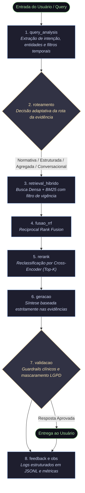

ARQUITETURA.md - Sistema RAG Adaptativo (Saúde Pública e Protocolos Clínicos)

1. Cenário escolhido, com duas frases de justificativa.
Cenário Selecionado: Cenário 2 · Saúde Pública e Protocolos Clínicos.
Justificativa 1: Oferece o maior impacto demonstrável e guardrails de segurança extremamente claros (a distinção qualitativa entre responder o conteúdo geral de um protocolo e recusar a prescrição individualizada para um paciente).
2. Diagrama do pipeline planejado, com os estágios nomeados (os mesmos nomes que vão para o campo stage do log).

Divisão de responsabilidades
Coordenador da Equipe: Patricia Starck Responsável por orquestrar os prazos, revisar PRs cruciais, unificar os módulos e garantir a coesão das Sprints (além de colocar a mão na massa).
> ⚠️ **PROPOSTA — aguardando validação do grupo.** A tabela abaixo é uma sugestão de divisão para os módulos que ainda estavam sem responsável. Confirmar com todos antes de considerar fechada.
<!-- prettier-ignore -->
Módulo / Componente Descrição da Responsabilidade Responsáveis (Integrantes)

1. Core & Coleta (src/fetch_corpus.py) Implementação do manifesto, comandos fetch, update, inventory, tratamento de rate limits e geração do inventário em JSON e Markdown. Patricia Zan
2. Ingestão, Chunking e Metadados Estratégias de parsing de PDFs dos PCDTs, serialização da RENAME e aplicação obrigatória de metadados de vigência e sensibilidade. Paula + Silvio (apoio)
3. Roteador Adaptativo & Query Analysis Módulo de decisão de rota (para qual base enviar a pergunta) e extração inteligente de entidades/filtros da query do usuário. Elcio
4. Recuperação Híbrida & RRF (retrieval) Implementação da busca vetorial + BM25, aplicação de filtros por metadado (essencial para o cenário de vigência) e fusão por RRF. Lindemir
5. Geração, Guardrails e Recusas Construção dos prompts, integração com o LLM, aplicação dos guardrails de saúde (recusa de prescrição individualizada) e mascaramento de LGPD. Sueli
6. Observabilidade, Logging & Testes Garantia do padrão JSONL (logs/), decorator de rastreio (run_id, tokens, latência) e estruturação da suíte de testes (tests/ com pytest). Patricia Starck
