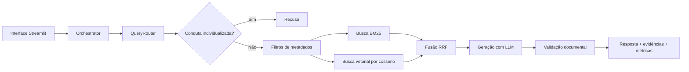

# 🩺 RAG Clínico — Saúde Pública e Protocolos Clínicos

Sistema experimental de consulta documental que utiliza **Retrieval-Augmented Generation (RAG)** para buscar evidências em Protocolos Clínicos e Diretrizes Terapêuticas (PCDTs) e gerar respostas fundamentadas em trechos recuperados.

> **Aviso:** ferramenta educacional e de apoio à consulta documental. **Não realiza diagnóstico, não prescreve medicamentos e não substitui profissionais de saúde.** Respostas produzidas por IA exigem conferência das fontes; a validação automática não garante correção clínica.

## 🎥 Demonstração em vídeo

Veja a apresentação da arquitetura, dos principais módulos e de uma consulta executada no sistema.

▶️ **[Assistir à demonstração do RAG Clínico no YouTube](https://youtu.be/QAusXWDHVjM)**

## Objetivo

Ajudar na localização e síntese de informações sobre protocolos clínicos, incluindo critérios documentais de inclusão, histórico de versões e evidências consultadas. O código organiza a coleta/manifestos, o processamento dos documentos, a recuperação de trechos relevantes, a geração de respostas e a observabilidade.

### Recursos implementados

- Interface **Streamlit** com seleção entre **Artrite reumatoide** e **Artrite idiopática juvenil**, situação documental (**Vigente** ou **Histórico**) e nível de detalhamento (**Mínima**, **Intermediária** ou **Completa**).
- Perguntas livres e perguntas de referência definidas em `benchmarks/perguntas.json`.
- **Roteamento adaptativo** por intenção, doença, medicamento e filtros em `src/query_router.py`.
- **Recuperação híbrida** usando BM25 e embeddings (similaridade de cosseno), combinados por **Reciprocal Rank Fusion (RRF)**.
- Geração de resposta baseada nos trechos recuperados, **verificação documental automática** e identificação de pedidos de conduta clínica individualizada.
- Abas para **resposta, evidências, observabilidade e logs**.

> O roteador reconhece mais temas do que os dois disponíveis no seletor da interface. A disponibilidade de respostas depende dos documentos efetivamente processados na pasta `output/`.

## Arquitetura



O módulo vetorial empregado na recuperação principal utiliza **similaridade de cosseno em Python**; o projeto também contém utilitários auxiliares para FAISS, mas **não** utiliza FAISS diretamente no fluxo principal mostrado acima.

## Organização dos códigos

| Caminho | Responsabilidade |
| --- | --- |
| `web/app.py` | Interface visual, formulário, abas e apresentação dos resultados. |
| `web/orchestrator.py` | Coordena roteamento, busca, geração, validação e tempo total da consulta. |
| `src/query_router.py` | Interpreta perguntas, identifica entidades/intenções e prepara filtros; sinaliza consultas individualizadas. |
| `src/retrieval/corpus_loader.py` | Carrega os JSONs dos trechos processados. |
| `src/retrieval/filtros.py` | Filtra documentos por doença, vigência e metadados. |
| `src/retrieval/bm25.py` | Calcula a relevância textual BM25. |
| `src/retrieval/vetorial.py` | Calcula similaridade com embeddings. |
| `src/retrieval/rrf.py` | Combina os rankings das duas buscas. |
| `src/retrieval/retrieval_hibrido.py` | Integra carregamento, filtros, buscas e RRF. |
| `src/generate.py` | Cria prompts, consulta o LLM, aplica regras de segurança e verifica respostas. |
| `src/llm/llm_embedding.py` | Solicita embeddings à API configurada. |
| `src/fetch_corpus.py` | Coleta fontes do manifesto e administra inventários/versionamento. |
| `src/chunking/process_md.py` e `src/chunking/run_chunking.py` | Transformam arquivos Markdown já preparados em trechos com metadados. |
| `src/embedding/generate_embeddings.py` | Adiciona vetores numéricos aos trechos JSON. |
| `config.py` e `corpus_manifest*.yaml` | Definições dos modelos, API e catálogo/fonte dos documentos. |
| `main.py` | Execução alternativa do pipeline pelo terminal. |
| `tests/` e `benchmarks/` | Testes automatizados e perguntas de referência. |

## 📦 Base documental v7 — download

Os arquivos JSON processados (trechos documentais e embeddings) não estão incluídos no histórico do Git porque o pacote tem aproximadamente 137 MB. A **base v7 utilizada na demonstração** está publicada separadamente no GitHub Releases:

- 📥 **[Baixar o ZIP da base documental v7](https://github.com/elciobbsjr/saude-publica-protocolos-clinicos/releases/download/v0.1-dados/output_chunking_19_102026.zip)**
- 📦 [Ver o Release e os detalhes do pacote](https://github.com/elciobbsjr/saude-publica-protocolos-clinicos/releases/tag/v0.1-dados)

O ZIP contém a pasta `output_chunking/v7/`. Extraia-o dentro da pasta `output/` do projeto, mantendo este caminho:

```text
saude-publica-protocolos-clinicos/
└── output/
    └── output_chunking/
        └── v7/
            ├── protocolos/
            ├── bulas/
            └── rename/
```

> **Versões:** a interface web carrega recursivamente os JSONs em `output/output_chunking/`, por isso funciona com a base v7. O inventário e o pipeline de preparação do projeto usam v8; a v7 não deve ser tratada como a versão documental mais recente nem misturada à v8 na mesma pasta de recuperação.

## Como executar localmente

### Pré-requisitos

- **Python 3.14** (versão mínima declarada pelo `pyproject.toml` e `.python-version`).
- **uv** (gerenciador de pacotes Python): <https://docs.astral.sh/uv/>.
- Acesso a um serviço de geração **compatível com a API da OpenAI**, com os modelos indicados no `config.py` ou equivalentes que estejam configurados.
- **Corpus processado** com os JSONs dos chunks, e embeddings quando quiser usar a busca vetorial.

Abra o PowerShell na **pasta raiz** do repositório e instale as dependências:

```powershell
uv python install 3.14
uv sync
uv pip install streamlit
```

> O Streamlit é instalado separadamente porque não consta nas dependências do `pyproject.toml` atual. Os arquivos `requirements-interface.txt` e `.env.example` não estão presentes neste repositório; não é necessário executá-los.

### Baixar e preparar a base v7

Para baixar o arquivo do Release e extraí-lo no local correto, execute no PowerShell:

```powershell
Invoke-WebRequest -Uri "https://github.com/elciobbsjr/saude-publica-protocolos-clinicos/releases/download/v0.1-dados/output_chunking_19_102026.zip" -OutFile ".\\output_chunking_19_102026.zip"
Expand-Archive -LiteralPath ".\\output_chunking_19_102026.zip" -DestinationPath ".\\output" -Force
Test-Path ".\\output\\output_chunking\\v7"
```

O último comando deverá retornar `True`. Quem já baixou o ZIP pode pular o `Invoke-WebRequest` e usar apenas o `Expand-Archive`.

Se precisar utilizar outro servidor ou modelos de IA, configure as variáveis `OLLAMA_URL`, `GENERATION_MODEL` e `EMBEDDING_MODEL` por meio de um arquivo `.env` criado manualmente na raiz. **Atenção:** o módulo `src/generate.py` também define seus próprios valores de URL e modelo; ajuste-o para usar a nova configuração se trocar a infraestrutura. A disponibilidade do servidor originalmente usado pela equipe não é garantida. Nunca publique chaves ou credenciais.

### Reconstruir o processamento v8 (opcional)

O pipeline de chunking de v8 depende de arquivos Markdown preparados previamente em `data/processed/v8/`; esses documentos não estão no GitHub. Caso tenha os dados necessários para reconstruir o corpus, utilize:

```powershell
uv run --no-sync python -m src.fetch_corpus fetch --manifest corpus_manifest.yaml
# Após obter e preparar os Markdown em data/processed/v8/:
uv run --no-sync python -m src.init.init_chunking
uv run --no-sync python -m src.init.init_embeddings
```

A geração de embeddings requer acesso ao servidor e ao modelo configurados. Não é necessário executar essas etapas para usar a base v7 já processada do Release.

### Iniciar a interface

```powershell
uv run --no-sync python -m streamlit run web/app.py
```

Acesse a URL local exibida no terminal (em geral `http://localhost:8501`). Na primeira consulta, o orquestrador carrega o corpus e inicia a recuperação dos trechos.

### Utilizar pelo terminal (opcional)

```powershell
uv run --no-sync python main.py "Quais são os critérios do PCDT vigente para artrite reumatoide?" --corpus output/output_chunking/v7 --llm
```

O comando acima seleciona explicitamente a base v7; o padrão de `main.py` aponta para v8. Sem `--llm`, o comando prepara a geração sem consultar o modelo de linguagem.

### Executar os testes

```powershell
uv run --no-sync python -m pytest -q
```

Os módulos podem ser testados separadamente; os testes que dependem de integração/serviços externos precisam das respectivas dependências e configuração. Na análise deste pacote, **33 testes do roteador e chunking passaram em ambiente isolado**; a suíte completa e a consulta ponta a ponta **não foram validadas** neste ambiente.

## Demonstração sugerida

1. Abra a interface e selecione **Artrite idiopática juvenil** + **Vigente** + **Intermediária**.
2. Faça a pergunta **“Quais são os critérios de diagnóstico?”** e clique em **Executar consulta**.
3. Apresente a resposta gerada e as abas **Evidências** e **Observabilidade**. Na demonstração realizada, foram recuperados 10 chunks.
4. Explique que a **verificação documental automática pode ser inconclusiva**: as respostas são experimentais e precisam ser conferidas no protocolo oficial.
5. Opcionalmente, teste uma solicitação de prescrição individualizada para demonstrar o mecanismo de recusa.

O vídeo completo está disponível na [seção de demonstração](#-demonstração-em-vídeo).

## Limitações e cuidados

- A verificação de fontes é **automática e experimental**, não uma auditoria de qualidade médica.
- O mascaramento de alguns identificadores pessoais é feito por **expressões regulares**, portanto não cobre todos os formatos ou tipos de dado sensível.
- A interface contém atualmente **duas doenças selecionáveis**, apesar de o roteador reconhecer outras.
- O fluxo depende de **arquivos externos processados** e de um **servidor de modelos acessível**.
- **Não utilize dados de pacientes reais** em testes, capturas de tela, vídeos ou logs; mantenha `data/raw/`, `data/processed/`, `output/` e `logs/` fora do repositório público.

## Equipe e créditos

Projeto acadêmico coletivo **Time 02 — Saúde**. Integrantes informados no README original:

- Elcio Berilo
- Lindemir Hoffmann
- Patrícia Starck
- Patrícia Zan
- Paula Femina
- Silvio Lima
- Sueli da Hora

Respeite a autoria coletiva, as permissões para divulgação dos documentos e o uso dos serviços externos. O projeto não traz licença de software explícita; nenhuma foi presumida.
